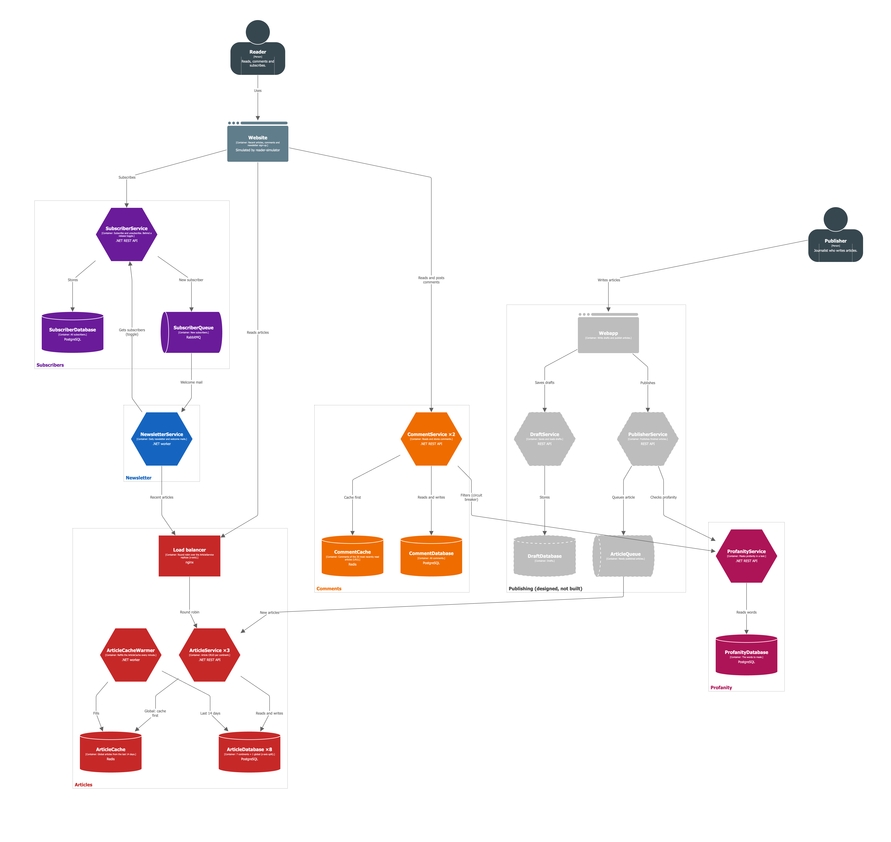
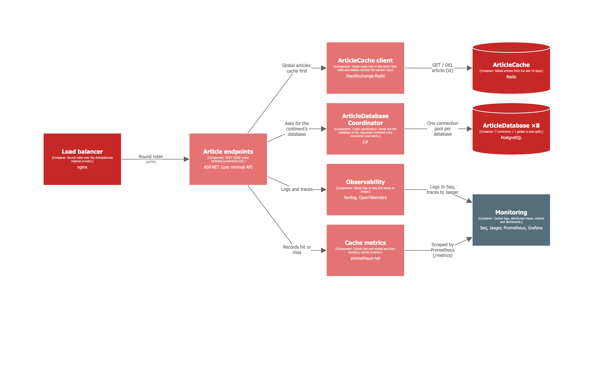

# HappyHeadlines

Development of Large Systems project - a positiv news system. 

Everything runs in Docker:

```sh
docker compose up --build -d
```

| What | Where |
|---|---|
| Articles, through the load balancer | http://localhost:8081/articles/global/1 |
| Dashboard (Grafana) | http://localhost:3030 |
| Logs (Seq) | http://localhost:5342 |
| Traces (Jaeger) | http://localhost:16686 |
| Prometheus | http://localhost:9091 |
| SubscriberQueue (RabbitMQ, guest / guest) | http://localhost:15673 |
| Transatlantic link control panel | http://localhost:8475 |
| Database viewer (DbGate) | http://localhost:8085 |

Stop with `docker compose down` (add `-v` to start the next time from fresh seed data).

## Architecture

| Level 2: containers | Level 3: inside ArticleService |
|---|---|
|  |  |

The model is [`docs/workspace.dsl`](docs/workspace.dsl) (Structurizr). To browse it:

```sh
docker run --rm -p 8090:8080 -v ./docs:/usr/local/structurizr structurizr/structurizr local   # http://localhost:8090
```

Each colour is a swimlane: its own services and its own data, nothing shared. The grey group (Webapp, DraftService/DraftDatabase, PublisherService, ArticleQueue) is part of the design but not built here, and the reader simulator stands in for the Website.

## How the requirements are covered

| Week | Requirement | Where |
|---|---|---|
| W35 | C4 diagrams (levels 1–2), plus level 3 of ArticleService | [`docs/workspace.dsl`](docs/workspace.dsl) |
| W36 | ArticleService: REST CRUD | [`ArticleEndpoints`](src/ArticleService/ArticleEndpoints.cs) |
| W36 | X-axis: 3 ArticleService replicas behind a load balancer | `deploy.replicas` in [`compose.yaml`](compose.yaml); [`article-lb.conf`](network/article-lb.conf) |
| W36 | Z-axis: one ArticleDatabase per continent plus a global one | [`ArticleDatabaseCoordinator`](src/ArticleService/ArticleDatabaseCoordinator.cs); [`appsettings.json`](src/ArticleService/appsettings.json); [`continent-db.sh`](db/continent-db.sh) |
| W37 | CommentService and ProfanityService, each with its own database, calling each other directly | [`CommentEndpoints`](src/CommentService/CommentEndpoints.cs); [`ProfanityService`](src/ProfanityService/Program.cs) |
| W37 | Circuit breaker in CommentService for when ProfanityService is unavailable | [`CommentService/Program.cs`](src/CommentService/Program.cs) (Polly); fallback in [`ProfanityClient`](src/CommentService/ProfanityClient.cs) |
| W38–W39 | Central logging, distributed tracing, metrics | [`Observability`](src/HappyHeadlines.Shared/Observability.cs) (Serilog → Seq, OpenTelemetry → Jaeger); [`CacheMetrics`](src/HappyHeadlines.Shared/CacheMetrics.cs) (Prometheus → Grafana) |
| W40 | ArticleCache (filled offline) and CommentCache (LRU, 30 articles), with a hit-ratio dashboard | See [Compulsory 1: caching](#compulsory-1-caching) |
| W43 | CI and CD with GitHub Actions; versioned images in GHCR | [`ci.yml`](.github/workflows/ci.yml); [`cd.yml`](.github/workflows/cd.yml) |
| W44 | SubscriberService, SubscriberDatabase, SubscriberQueue; NewsletterService in its own swimlane | [`SubscriberService`](src/SubscriberService/Program.cs); [`NewsletterSender`](src/NewsletterService/NewsletterSender.cs); [`WelcomeMailConsumer`](src/NewsletterService/WelcomeMailConsumer.cs) |
| W44 | SubscriberService behind a release toggle, switched without a redeploy | [`features/features.json`](features/features.json); [`FeatureToggles`](src/HappyHeadlines.Shared/FeatureToggles.cs); used in [`NewsletterSender`](src/NewsletterService/NewsletterSender.cs) and [`SubscriberService`](src/SubscriberService/Program.cs) |
| W45 | Three GAF tactics, with before and after | See [Sustainability: three GAF tactics](#sustainability-three-gaf-tactics) |

## Containers

Every container carries `happyheadlines.c4` and `happyheadlines.description` labels (`docker inspect`, or the Docker Desktop UI).

| Container | C4 container | What it does |
|---|---|---|
| `article-lb` | Load balancer | nginx: spreads requests round robin over the ArticleService replicas |
| `article-service` ×3 | ArticleService | REST CRUD under `/articles/{continent}/{id}`; global reads go through the ArticleCache |
| `article-db` | ArticleDatabase (global) | PostgreSQL in North America: 300 articles, behind `transatlantic-link` |
| `article-db-<continent>` ×7 | ArticleDatabase (continent) | PostgreSQL: a few articles per continent |
| `article-cache` | ArticleCache | Redis: global articles from the last 14 days |
| `article-cache-warmer` | ArticleCache (offline process) | Copies the last 14 days of global articles into the ArticleCache, on start and then every minute |
| `comment-service` ×2 | CommentService | Comments from the CommentCache or database; new comments pass the ProfanityService |
| `comment-db` | CommentDatabase | PostgreSQL in North America: all comments |
| `comment-cache` | CommentCache | Redis: comments of the 30 most recently read articles |
| `profanity-service` | ProfanityService | Masks profanity in a text |
| `profanity-db` | ProfanityDatabase | PostgreSQL: the words to mask |
| `subscriber-service` | SubscriberService | Subscribe, unsubscribe, list; publishes new subscribers to the SubscriberQueue |
| `subscriber-db` | SubscriberDatabase | PostgreSQL: subscribers |
| `rabbitmq` | SubscriberQueue | RabbitMQ: new subscribers on their way to NewsletterService |
| `newsletter-service` | NewsletterService | Sends the newsletter every minute (daily in production); sends welcome mails from the queue |
| `reader-simulator` | Website (simulated) | 5 simulated readers: open an article, read its comments, sometimes comment or subscribe |
| `seq`, `jaeger`, `prometheus`, `grafana` | Monitoring | Logs, traces, metrics, dashboard |
| `transatlantic-link`, `-setup`, `-control` | Network (simulated) | Toxiproxy: 100 ms between Europe and North America, and a control panel |
| `database-viewer` | | DbGate: browse the global ArticleDatabase, the CommentDatabase and both caches, read-only |

**Seed data:** 300 global articles; article *n* was published *n* × 5 hours ago, so articles 1–67 are from the last 14 days. Each has 3 comments. Every continent database has 5 articles named after its continent.

## Scale cube

**Z-axis (split by continent).** Every request names its continent: `/articles/europe/3`, `/articles/global/12`. The [`ArticleDatabaseCoordinator`](src/ArticleService/ArticleDatabaseCoordinator.cs) is the coordination component. It holds one connection pool per database and hands the endpoint the one for that continent. An unknown continent is a 404.

```sh
curl localhost:8081/articles/europe/1   # "Good news from europe #1"
curl localhost:8081/articles/asia/1     # "Good news from asia #1": same id, another database
curl -X POST localhost:8081/articles/oceania -H 'Content-Type: application/json' -d '{"title": "Reef recovers", "content": "Coral is back."}'
```

**X-axis (cloning).** Three identical, stateless ArticleService replicas run behind nginx. All their state lives in the databases and the ArticleCache, so any replica can answer any request.
- **Finding the replicas:** Docker's DNS answers `article-service` with one address per replica. nginx re-resolves the name every 5 seconds, so scaling up or down is picked up.
- **Spreading the load:** requests go round robin.
- **Failures:** a replica that fails 3 times within 10 seconds is left out for 10 seconds, and a request that hits a dead replica is retried on the next one (never for POST).
- **Which replica answered:** the `X-Upstream` header says.

```sh
for i in 1 2 3 4 5 6; do curl -s -o /dev/null -D - localhost:8081/articles/europe/1 | grep X-Upstream; done
docker compose up -d --scale article-service=5   # nginx picks up the new replicas
```

## Fault isolation

**CommentService and ProfanityService** are separate swimlanes:
- each has its own container and its own database, so nothing is shared;
- the one synchronous call between them (filtering a new comment) goes through a Polly circuit breaker:
  - the call times out after 1 second;
  - when half the calls within 10 seconds fail (at least 5 calls), the circuit opens for 15 seconds, and CommentService stops calling;
  - then one trial call is let through (half-open). If it succeeds, the circuit closes again.
- While ProfanityService can't be reached, a short built-in word list takes over. Comments keep working, slightly less filtered.
- Reading comments never touches ProfanityService.

```sh
docker compose stop profanity-service    # Seq: "Circuit to ProfanityService opened"; comments still post
docker compose start profanity-service   # after 15 s: "half-open", then "closed again"
```

**SubscriberService and NewsletterService** are decoupled by the SubscriberQueue: new subscribers wait in RabbitMQ until NewsletterService takes them. NewsletterService's HTTP calls (subscribers, recent articles) use the standard resilience handler (timeouts, retries, circuit breaker). A failure skips one newsletter; the service keeps running.

## Design to be monitored

- **Logs:** every service uses Serilog through [`Observability`](src/HappyHeadlines.Shared/Observability.cs) and writes to Seq, tagged with `Service`. Filter on `Service = 'CommentService'` or on a `TraceId`.
- **Traces:** OpenTelemetry instruments ASP.NET Core, HttpClient, Npgsql and MassTransit and exports to Jaeger. The `traceparent` header carries a trace across services (through nginx too) and RabbitMQ messages, so one reader request is one trace. A global article read from the cache has no `postgresql` span; a miss has one of about 100 ms (the Atlantic).
- **Metrics:** cache hits, misses, lookup time and evictions per replica, scraped by Prometheus and shown in Grafana. The per-replica panel also shows the load balancer spreading the reads.

## CI/CD

- **[CI](.github/workflows/ci.yml):** on every push and pull request to `main`: restore, build, and run the [tests](tests/HappyHeadlines.Tests).
- **[CD](.github/workflows/cd.yml):** when CI passes on `main`, every service is built from the one [`Dockerfile`](Dockerfile) and pushed to the GitHub Container Registry, for example `ghcr.io/<owner>/happyheadlines-article-service:1.0.<CI run number>`, and `:latest`.

## Release toggle

[`features/features.json`](features/features.json) is mounted into SubscriberService and NewsletterService and re-read when it changes. Setting `"SubscriberService": false` hides the whole service without a redeploy:
- SubscriberService answers 404 on every endpoint;
- NewsletterService stops calling it and sends no newsletter.

Set it back to `true` and both pick it up within seconds.

## Sustainability: three GAF tactics

Each tactic is its own commit, so `git show <commit>` is the before and after.

| Tactic | Change | Before | After |
|---|---|---|---|
| Bulk Fetch Data | The ArticleCacheWarmer writes its 67 articles to Redis in one batch, not one round trip each ([`ArticleCacheRefresher`](src/ArticleCacheWarmer/ArticleCacheRefresher.cs)) | 54 ms first refresh, then 6–11 ms | 23 ms first refresh, then 2–7 ms |
| Reduce Bundle Size | Runtime image `aspnet:10.0` → `aspnet:10.0-alpine` ([`Dockerfile`](Dockerfile)) | 375–385 MB per image, 2,659 MB for all 7 | 190–200 MB per image, 1,364 MB (-49%) |
| Reduce Logging | ASP.NET Core and HttpClient log only warnings and errors; traces cover each request ([`Observability`](src/HappyHeadlines.Shared/Observability.cs)) | 17,296 log events per minute | 14 per minute |

## Compulsory 1: caching

**Distance to North America:** the global ArticleDatabase and the CommentDatabase are in North America, and the services are in Europe. The services reach them through `transatlantic-link`, a [Toxiproxy](https://github.com/Shopify/toxiproxy) container that delays every database response by 100 ms. The Redis caches are in Europe.

### Distributed cache (Redis), not IMemoryCache or HybridCache

- **ArticleCache:** a separate offline process fills it, and 3 ArticleService replicas read it. With an in-memory cache, every replica would hold its own copy and run its own refresh. That means three times the reads against the database in North America, which is the thing the cache exists to protect, and a new replica would start empty. With Redis there is one copy, filled once, and every replica shares it.
- **CommentCache:** "the 30 most recently read articles" is one list for the whole service. In memory, each replica would keep its own 30, in a different order.
- **HybridCache** (in-memory in front of Redis) would make hits slightly faster, but each replica's in-memory copy can go stale. It also has no limit by number of articles. A Redis hit already takes under 1 ms, against more than 100 ms for a miss.
- **The cost:** one more container per cache, and a network hop on every lookup. If the ArticleCache is down, ArticleService reads the database instead.

### ArticleCache

- **Never filled on a miss:** a read that misses (an article older than 14 days, or anything before the first refresh) goes to the database every time. Only the offline process fills the cache.
- **Refresh interval:** 1 minute for the demo; in production it might be 15 minutes. Each entry lives for two refresh intervals. Every refresh renews the articles still within 14 days, so an article that ages out disappears on its own.
- **Edits:** updating or deleting a global article through ArticleService removes its cached copy, and the next refresh brings the new version.

### CommentCache

- **Per-article entries:** one key per article (`comments:{id}`) holds all its comments. A sorted set (`comments:last-read`) records when each article was last read.
- **On a miss:** read the database, store the comments, mark the article as read, and if more than 30 articles are cached, remove the ones read longest ago. Redis can only evict by memory use, not by count, so this rule is written in the service.
- **New comments:** a new comment removes its article from the cache, so the next read loads the fresh list.
- **Two replicas:** they can interleave these steps, so the worst case is one extra eviction. That's acceptable for a cache.

### Demo

1. **Dashboard:** http://localhost:3030.
   - ArticleCache hit ratio around **80%**: readers ask for last-14-days articles 80% of the time; older ones always miss.
   - CommentCache around **25–30%**: 30 slots for readers spread over 300 articles. The evictions panel shows the LRU at work.
2. **Hit versus miss:** under 1 ms for a hit against about 100 ms for a miss (also the `X-Cache` header).
3. **Move North America further away:** on the control panel (http://localhost:8475), drag the Articles slider to 1000 ms. Misses slow down; hits don't change.
4. **Cut the link:** drag the slider all the way right. Articles from the last 14 days are still served from the ArticleCache; every miss fails. After 2 minutes the refresh has failed twice, the entries expire, and everything fails. Drag it back to restore.

   The same without the panel:
   ```sh
   curl -X POST localhost:8474/proxies/article-db/toxics/distance -d '{"attributes": {"latency": 1000}}'
   curl -X POST localhost:8474/proxies/article-db -d '{"enabled": false}'
   curl -X POST localhost:8474/proxies/article-db -d '{"enabled": true}'
   ```
5. **Cold ArticleCache:** `docker compose exec article-cache redis-cli FLUSHALL`, then `docker compose restart article-cache-warmer`.
6. **The LRU list:** `docker compose exec comment-cache redis-cli ZRANGE comments:last-read 0 -1 WITHSCORES` (least recently read first).
